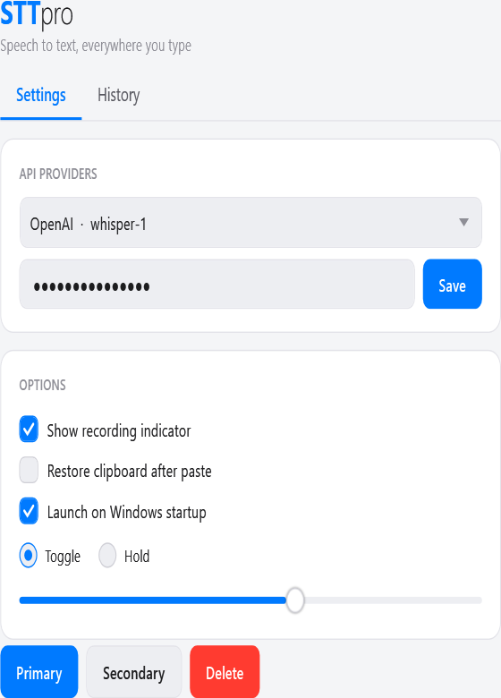

# STTpro

**Speech to text, everywhere you type.**

STTpro is a lightweight Windows tray app that turns your voice into text in any application. Hold a hotkey, speak, and the transcription is pasted straight into whatever you're typing — editor, browser, chat, terminal. Optional LLM post-processing ("Smart Prompts") can clean up, translate, or reformat what you said on the fly.

| Light | Dark |
| :---: | :---: |
|  |  |

<sub>The UI follows your Windows light/dark setting automatically.</sub>

## Features

- 🎙️ **Push-to-talk transcription** — hold a global hotkey to record, release to transcribe and paste.
- 🔁 **Toggle & paste-last hotkeys** — start/stop hands-free, or re-paste your last transcription.
- 🧠 **Smart Prompts** — post-process a recording through an LLM (e.g. "clean up grammar", "translate to English", "make it a bullet list"), each bound to its own hotkey.
- 🔌 **Bring your own provider** — configurable STT and LLM providers/models with custom base URLs (OpenAI-compatible endpoints, local servers, etc.).
- ⌨️ **Flexible output** — clipboard paste, direct Unicode typing, copy-only, or save-to-history.
- 🌐 **Multi-language** — auto-detect or pin a language (English, Hebrew, French, Spanish, German, Arabic, Russian, …).
- 🕘 **Local history** — every transcription stored locally in SQLite; search, copy, export (JSON/text). Nothing is sent anywhere except your chosen API provider.
- 📊 **Usage & cost estimate** — track transcription count, audio minutes, and approximate spend.
- 🌗 **Light & dark theme** — follows your Windows appearance setting automatically, including native title bars.
- 🔒 **Secure key storage** — API keys are encrypted at rest with Windows DPAPI, never written to the repo or history.
- 🚀 **Runs in the tray** — optional launch on Windows startup, minimal footprint.

## Requirements

- Windows 10 (1809+) or Windows 11
- [.NET 8 SDK](https://dotnet.microsoft.com/download/dotnet/8.0) (to build) or the .NET 8 Desktop Runtime (to run a published build)
- An API key for a supported speech-to-text provider (and an LLM provider if you use Smart Prompts)

## Build & run

```bash
# from the repo root
dotnet build STTpro.sln -c Release

# run the app
dotnet run --project src/STTpro.App -c Release
```

On first launch the Settings window opens automatically so you can pick a provider and paste your API key. After that, STTpro lives in the system tray — left-click the tray icon for Settings, right-click for the menu.

### Default hotkeys

| Action | Shortcut |
| --- | --- |
| Hold to talk | `Ctrl + Space` |
| Toggle recording | `Ctrl + Shift + Space` |
| Paste last transcription | `Ctrl + Shift + V` |
| Smart Prompt 1–9 | `Ctrl + Shift + 1…9` |

All hotkeys are rebindable in **Settings → Hotkeys**.

## macOS (menu-bar app)

A native Swift/SwiftUI version lives in [`mac/`](mac/) and is independent of the Windows code. It runs in the menu bar (microphone icon, no Dock icon) and covers the core loop: push-to-talk, toggle recording, paste last transcript, Smart Prompts, OpenAI-compatible STT/LLM providers with custom base URLs, local SQLite history, and Hebrew/multi-language support.

**Requirements:** Apple Silicon Mac, macOS 14 or later, and either full Xcode or just the Command Line Tools (`xcode-select --install`).

```bash
cd mac
scripts/build-app.sh            # builds mac/build/STTpro.app
scripts/build-app.sh --install  # also copies it to /Applications (needed for "Launch at login")
open build/STTpro.app
swift test                      # unit tests for providers, punctuation, history
```

The script uses `xcodebuild` when full Xcode is installed (or `BUILD_TOOL=xcodebuild`) and SwiftPM otherwise. You can also open `mac/Package.swift` in Xcode.

**First run.** A welcome window walks you through setup:

1. **Microphone.** macOS asks the first time you record. The mic is on only while you're dictating.
2. **Accessibility.** Lets STTpro press ⌘V in the app you're typing in. Turn on STTpro under *System Settings › Privacy & Security › Accessibility*. Without it, the text is left on the clipboard for you to paste.
3. **API key.** Go to *Settings › Providers*, choose a provider, paste your key, and click Save. Keys are stored only in your login Keychain (item "STTpro API Key"), never in files, logs or the repo.

| Action | Default shortcut |
| --- | --- |
| Hold to talk | `⌃ Space` |
| Toggle recording | `⌃⇧ Space` |
| Paste last transcription | `⌃⇧ V` |
| Smart Prompt 1–9 | `⌃⇧ 1…9` |

> **⌃Space and keyboard languages:** if you use more than one input source (e.g. English + Hebrew), macOS already uses ⌃Space for *Select the previous input source*. STTpro detects this and offers to switch to `⌥ Space`. You can also turn the macOS shortcut off in *System Settings › Keyboard › Keyboard Shortcuts › Input Sources* and switch languages with the 🌐 Globe key instead.

**Where things live:** settings are in `~/Library/Application Support/STTpro/settings.json`, history in `~/Library/Application Support/STTpro/history.db` (same schema as Windows), and logs in `~/Library/Logs/STTpro/sttpro.log`.

**Rebuilding:** local builds are ad-hoc signed, so after each rebuild macOS treats STTpro as a new app. You may need to turn Accessibility off and on again for it, and click *Always Allow* when it first reads your key from the Keychain. To avoid this, sign with your own certificate: `SIGN_IDENTITY="Apple Development: you@example.com (TEAMID)" scripts/build-app.sh --install`.

**Not yet ported from Windows:** silence-based chunked transcription, microphone picker (uses the macOS default input), direct Unicode typing output, pre-roll buffer, and JSON/text history export.

## Project layout

| Project | Responsibility |
| --- | --- |
| `STTpro.App` | WPF UI, tray, overlays, and the centralized theme system (`Themes/`, `Theme/ThemeManager.cs`) |
| `STTpro.Core` | Audio capture, STT/LLM providers, hotkeys, history, settings, secure storage |
| `STTpro.Interop` | Win32 interop helpers |
| `STTpro.Core.Tests` | Unit tests |
| `mac/` | Native macOS menu-bar app (Swift Package: `STTproCore` + `STTpro`) |

## Privacy

Audio is streamed only to the STT/LLM provider you configure. Transcriptions and settings are stored **locally** on your device; API keys are encrypted with Windows DPAPI. STTpro has no telemetry and no backend of its own.

## License

[MIT](LICENSE) © Nir Lever
